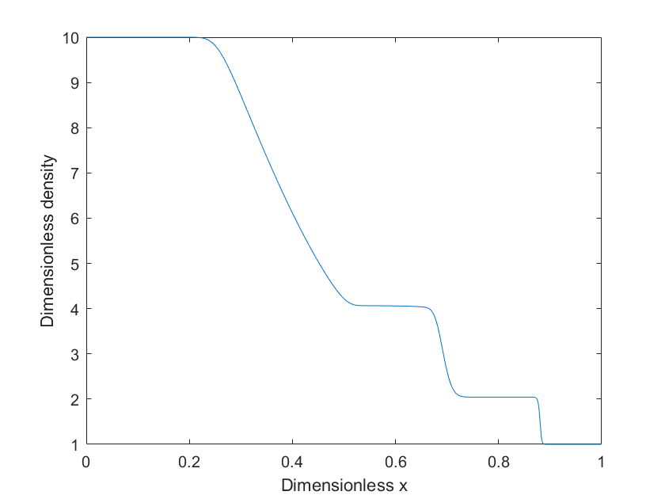
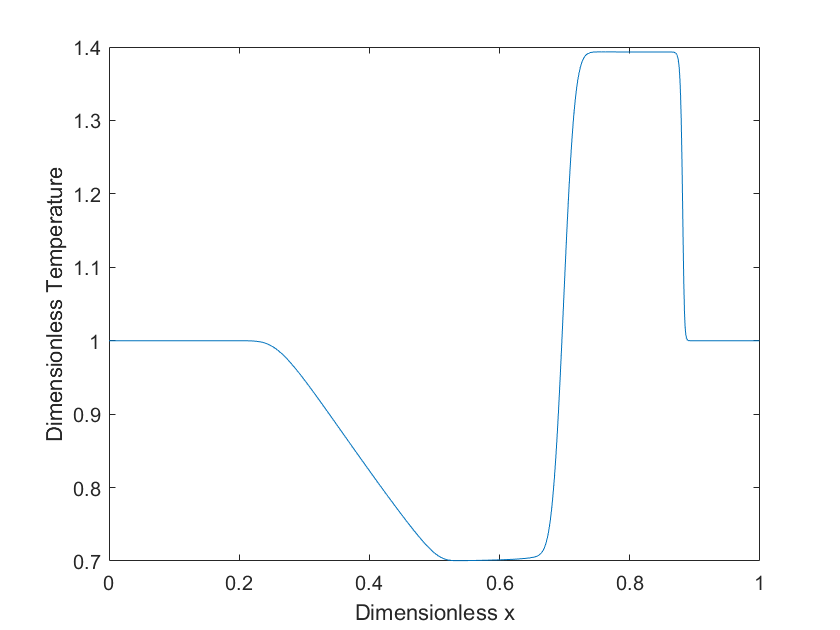

# 1D Shock Tube using OpenCL

This is a simple demonstration of a Finite Volume Method (FVM) solving Sod's 1D shock tube problem
using OpenCL.

## SHLL Computation

The SHLL method computes split fluxes ($F^+$ and $F^-$) in each cell which are then used to compute the next flux across any surface. This is a critical number splitting - in this case, we are solving the 1D Euler equations, so the critical number is the Mach number.

For each timestep, the SHLL method (1st order implementation):

* Computes $F^+$ and $F^-$ in each cell $i$ from 0 to $N-1$.
* Computes the net flux across the cell surface seperating cell $i$ and $i+1$:  
    $F_{i+0.5} = F^+_i + F^-_{i+1}$
* Evolves the conserved quantity $U$ over a time step from $k$ to $k+1$:  
    $U^{k+1}_i = U^k_i - \frac{\Delta t}{\Delta x}[F^k_{i+0.5}-F^k_{i-0.5}]$
* Updates the primitives vector $P$ (density, velocity, temperature) from $U$.

In this code, these steps are found in the OpenCL kernel source codes:

* shll_f_from_p.cl -> compute_f_from_p() function
* shll_u_from_f.cl -> compute_u_from_f() function, and
* shll_p_from_u.cl -> compute_p_from_u() function.

## Computing SHLL Shock Tube with OpenCL

For a simple guide of OpenCL, you should read [this](./../vector-demo/README.md)  

For each of the functions shown above, we need to:

* Load the source code at runtime, and create a program using the source:

```c
    kernel_source = read_kernel_source("shll_f_from_p.cl");
    cl_program f_from_p_program = clCreateProgramWithSource(context, 1, (const char**)&kernel_source, NULL, &ret);
```

* Build the program

```c
    ret = clBuildProgram(f_from_p_program, 1, &device_id, NULL, NULL, NULL);
    if (ret != CL_SUCCESS) {
        size_t log_size;
        clGetProgramBuildInfo(f_from_p_program, device_id, CL_PROGRAM_BUILD_LOG, 0, NULL, &log_size);
        char* log = malloc(log_size);
        clGetProgramBuildInfo(f_from_p_program, device_id, CL_PROGRAM_BUILD_LOG, log_size, log, NULL);
        fprintf(stderr, "Program build failed:\n%s\n", log);
        free(log);
        exit(1);
    }
```

* Create the kernel:

```c
    cl_kernel f_from_p_kernel = clCreateKernel(f_from_p_program, "compute_f_from_p", &ret);
```

These 3 kernels are then fed into the command queue for the transient simulation:

```c
    // Start time stepping
    for (int step = 0; step < NO_STEPS; step++) {
        printf("Step %d of %d\n", step, NO_STEPS);
        // Compute the split fluxes
        ret = clEnqueueNDRangeKernel(command_queue, f_from_p_kernel, 1, NULL, &global_item_size, &local_item_size, 0, NULL, NULL);
        // Update U based on the split fluxes
        ret = clEnqueueNDRangeKernel(command_queue, u_from_f_kernel, 1, NULL, &global_item_size, &local_item_size, 0, NULL, NULL);
        // Update P from U
        ret = clEnqueueNDRangeKernel(command_queue, p_from_u_kernel, 1, NULL, &global_item_size, &local_item_size, 0, NULL, NULL);
    }
```

## Expected Results

When executed, the code should produce a file (results.txt) with columns of cell position, density, velocity and temperature. When plotted, the dimensionless (normalised) density and temperature are shown below:




